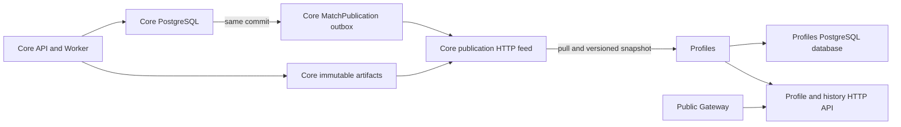

# Player Profiles



Profiles is a separately deployable NestJS application. It imports public contracts only. Core retains its existing parser, normalizer, scoring, worker, storage and match routes. The same PostgreSQL server can host both databases in local Compose. The Profiles runtime login owns its database and has no rights on Core tables; the database provisioning process is a separate one-shot container. Profiles never mounts Core artifacts.

Profiles has its own build, deployment, data and recovery. The PostgreSQL outbox and versioned pull API provide durable delivery and replay. Public profile and history reads use Gateway. Synchronization calls the authenticated Core feed directly, so it can continue while Gateway is down. [Gateway routing](api-gateway-and-service-layout.md).

## Publication protocol

The Core migration creates `MatchPublication` and bootstraps existing published pointers. The trigger writes events inside the same transaction as the result or deletion pointer. This covers PARSE, RESCORE, rating rebuild, EVP backfill, admin publication and deletion/recovery without a client-specific hook. Tombstones survive the match FK cascade. A transaction-scoped advisory lock serializes revision allocation and is released at commit; a fast commit cannot overtake a smaller revision. Rollbacks can leave gaps. No remote calls or indefinite subscriber retention locks occur in a Core write transaction.

The bearer-authenticated `GET /api/v1/internal/match-publications?after=<revision>` returns up to 100 notifications in revision order under `match-publications@1`. The authenticated `GET /api/v1/internal/match-publications/:id` reads the current pointer and revision in one database snapshot and validates the bounded immutable artifact before projecting `match-publication-state@1`. It may return a newer revision than requested via the feed. `EXCLUDED` represents a deletion or a canonical policy outside the H3 profile scope. Corrupt canonical sources remain errors. Corrupt or absent EVP leaves independent measurements readable with unknown EVP outcomes; its own API still reports the integrity failure.

Profiles persists the feed cursor and pending match IDs in one transaction, then fetches and applies snapshots independently. Per-match revision fencing and a primary key on `(steamId, matchId)` make replay idempotent. Pending errors back off and other matches proceed. Ready status lists unprocessed and retrying counts. Pending work and tombstones survive restart. Duplicate byte-identical uploads across parser versions are deduplicated when reading by SteamID and demo SHA-256. The newest surviving uploaded record wins, with match ID as stable tie-break. If it is deleted, an older surviving copy can become the representative. The latest trustworthy nickname is derived from displayed match history.

## Development and recovery

```powershell
powershell -ExecutionPolicy Bypass -File .\scripts\dev-up.ps1
powershell -ExecutionPolicy Bypass -File .\scripts\dev-down.ps1
```

Public profile reads use `http://127.0.0.1:5173/api/v1/players/…`. Direct Profiles diagnostics use loopback port 3001 by default (`-ProfilesPort`). The helper keeps PostgreSQL credentials and the Core publication token in `_local-dev` and redacts them from the rendered Compose config. On the diagnostic port, `GET /api/v1/health` is liveness and `GET /api/v1/ready` reports storage availability and catch-up state. Profiles can serve its checkpointed projection while Core is offline.

To run Profiles natively, use an owned PostgreSQL database, set `PROFILES_DATABASE_URL`, `PROFILES_CORE_URL` and the same `MATCH_PUBLICATION_TOKEN` as Core, then run `pnpm exec turbo run build --filter=@who-ruined/profiles...`, `pnpm --filter @who-ruined/profiles migrate` and `pnpm --filter @who-ruined/profiles start`. The service binds to localhost by default. PostgreSQL migrations live in `apps/services/profiles/prisma/migrations`; the Core feed migration resides in `apps/core/prisma/migrations`.

The profile route reads a saved aggregate and returns its revision and freshness in response headers. Use `pnpm --filter @who-ruined/profiles rebuild --replay-core-feed` with the Profiles connection configured to replay the retained feed within the same Core database lineage. The existing projections remain readable with a rebuilding marker. Use the verification and repair modes to diagnose local aggregate differences. [Projection recovery and measurement](profiles-aggregation-and-demo-reuse.md#profile-projection).

`X-Profile-Sync-State` reflects the requested player. `CURRENT` requires a healthy, caught-up Core feed and no pending work that can affect that player. Tombstones can affect the previous projected roster. A validated snapshot for the pending revision can identify the union of the previous and incoming rosters, even when saving its projection needs to be retried. Pending work with unknown scope, a Core outage or an unread feed keeps profiles `STALE`. Global backfill or replay returns `REBUILDING` and keeps any saved summary readable. A missing profile returns 404 when current and 503 while its result is still uncertain. The internal readiness endpoint still reports the entire pending queue.

## Measurement boundaries

| Channel | Degradation and retained data |
| --- | --- |
| Parser and normalization | Equipment sampling's explicitly typed native capability failure leaves equipment evidence empty. The primary parser envelope, file binding and normalized relation checks remain strict. Unsafe streams cannot be repaired by guessing. |
| M2 and measured stats | Absent or invalid rounds are isolated. For kills, assists, opening and trade counts, the measured projection uses the existing M2 definitions on supported rounds; KAST requires confirmed roster exposure for the round. Without timing evidence, a trade rate is unavailable. |
| Damage, ADR, HE and fire | Verify the same capped enemy HP damage against the target's round ledger. Confirmed hits contribute to totals even in some incomplete rounds. ADR uses only complete rounds with an observed damage stream; its numerator and denominator describe the same rounds. A broken HP chain stays unknown until a valid observation re-establishes it. |
| Flash | Event counts can remain available when durations are missing. Verified duration sums can survive as partial observations. |
| H3 explanation | Policy-gated families, unavailable contributions, frozen identity and award thresholds retain their original semantics. The measured projection is independent when some ratings or families are withheld. |
| Radar | Existing comparison logic and the confirmed-evidence extension retain their semantics. Profile axes divide exact stored Radar numerators by the sum of comparable counted rounds and use the same normalization version. Count-based axes are expressed per ten rounds. A lower-bound contribution without an exact comparable rate stays in measured totals. |
| EVP/APIs | Own report readers validate integrity. Missing or invalid optional EVP leaves match measurements and separate known awards readable; an unknown EVP outcome cannot become zero. |
| Profiles | Aggregates report available, partial, unavailable and inapplicable values independently. No repair of canonical byte streams, unknown denominators, unknown identity or guessed awards. |

The pipeline does not infer match timestamps from upload time. Current canonical results lack reliable played time, so the response keeps it null and exposes the distinct database upload timestamp. Hostage rescues use recorded supplemental events; a missing observation cannot confirm zero. The local read model handles only H3. Existing canonical reader compatibility remains separate.
